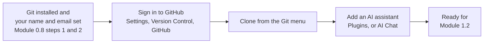

# Module 0.11: Use IntelliJ IDEA with Git, GitHub and an AI assistant

**Audience:** Anyone whose team works in IntelliJ IDEA instead of VS Code, or who
uses both. Read [Module 0.3](module-0-3-what-is-github.md) first. Conditional:
skip it if you work in VS Code ([Module 0.7](module-0-7-set-up-vs-code.md) and
[Module 0.8](module-0-8-connect-vs-code-to-git-github-and-an-llm.md)) and never
open a JetBrains IDE.

**Format:** Hands-on sign-ins and plugin installs, done once. The steps are the
same as in Module 0.8; this page says where they live in IntelliJ IDEA.

**Timing budget:** ~20 minutes, most of it waiting on installs and browser
sign-ins.


**Permissions:** permission to install software on your machine; a GitHub
account (with single sign-on if your organization requires it); for company
repositories, your company initials and company email, as in Module 0.8 step 2.

**Starting state:** IntelliJ IDEA is installed. Git may or may not be, and Git may
or may not know who you are.

**Success state:** IntelliJ IDEA lists your GitHub account under **Settings,
Version Control, GitHub**; you can clone a repository from the **Git** menu; `git
config --global user.name` and `user.email` print the values you meant when you
run them in the IDE's terminal; and at least one AI assistant opens inside the
IDE and asks before it changes files.

**Likely errors:**

- The IDE asks for a GitHub password again and again: it is not saving your
  account. Set the password policy (step 3 below), or sign in again with the
  browser.
- A token is rejected for missing permissions: the IDE needs the scopes `repo`,
  `gist`, `read:org`, `workflow`, `read:user` and `user:email`. JetBrains' page says
  fine-grained tokens are not fully supported out of the box, so prefer the
  browser sign-in unless your organization requires a token.
- The sign-in goes to github.com but your company uses another server: add the
  account with **Log In to GitHub Enterprise** and enter your company's server
  address.
- The Copilot plugin installed but nothing happens: restart the IDE, then sign in
  from the **Tools** menu (step 4).
- Junie or AI Assistant says you have no licence: both need a JetBrains AI
  licence or trial, which your team may manage centrally. Ask before you start a
  trial on a personal account.

**Cleanup:** none needed. To remove a GitHub account you added by mistake, open
**Settings, Version Control, GitHub** and remove it there. Disable or uninstall a
plugin under **Settings, Plugins**.

## Why this exists

JetBrains IDEs are a different tool for the same job. Git does not change: the
same commits, branches and habits apply, and Modules 1.2 onward work in any editor
that gives you a terminal. What changes is where the menus are. Module 0.8 tells
a VS Code user to click the Accounts icon; in IntelliJ IDEA there is no such icon,
and a colleague who learned the VS Code steps has no path. This page is that path.
It is not a full IntelliJ tutorial, and it says only what was checked against the
vendors' pages (see "Sources and dates").



What this shows: the same order as Module 0.8, with the steps that depend on the
editor in the middle. Git and your identity come first, because the IDE calls the
Git on your machine.

## 1. Git and your identity

IntelliJ IDEA ships with the Git plugin turned on, but the plugin drives a Git
program; it does not replace it. Do Module 0.8 step 1 (install Git) and step 2
(tell Git who you are), then open the terminal in the IDE and run:

```powershell
git --version
git config --global user.name
git config --global user.email
```

If you must use Git from WSL, JetBrains documents setting the **Path to Git
executable** under **Settings, Version Control, Git**. Most colleagues do not need
that.

## 2. Sign in to GitHub

1. Press `Ctrl+Alt+S` (on macOS, `⌘ ,`) to open Settings, then choose **Version
   Control, GitHub**.
2. Click **Add** and choose **Log In via GitHub**. A browser window opens; sign in
   there, with a second factor if your account has one. JetBrains says this uses
   OAuth 2.0.
3. If your organization uses a company server or Enterprise Cloud with data
   residency, choose **Log In to GitHub Enterprise** instead and type the server
   address in the **Server** field. Ask your facilitator or admin which applies,
   as in Module 0.8 step 3.

The GitHub and Git plugins are bundled and enabled by default. You can add more
than one account, for example a personal and a company one; the same rule as in
Module 0.8 applies, so check which account the IDE uses before you push to a
company repository.

## 3. Clone, and let the IDE remember you

Clone from the **Git** menu (**Git, Clone**), or from the **Clone Repository**
button on the Welcome screen. You can pick a repository from the GitHub account
you just added or paste its URL. A cloned repository gets its remote named
`origin` for you.

JetBrains offers three ways to store the password the IDE uses for a Git remote:
the system keychain (macOS and Linux), a KeePass database, or only until the IDE
restarts. If it keeps asking, check this setting; JetBrains' page on setting up a
Git repository ("Configure a password policy") shows where. Do not choose a way
of storing credentials your organization forbids.

## 4. Add an AI assistant

Which assistant you add depends on what your team uses, so ask first. Read
[Module 0.6: What Is an LLM Assistant?](module-0-6-what-is-an-llm-assistant.md)
before you start: it explains what these tools do on their own and why you check
what they did. Two are in common use inside IntelliJ IDEA.

| Assistant | What it is | How to add it |
| --- | --- | --- |
| **GitHub Copilot plugin** | GitHub's plugin: chat and suggestions in the IDE, using your GitHub Copilot access | **Settings, Plugins, Marketplace**, install **GitHub Copilot**, restart, then **Tools, GitHub Copilot, Login to GitHub**. Copy the device code, finish in the browser, and enter the code. A managed account on GHE.com needs extra configuration first |
| **JetBrains AI Assistant** | JetBrains' own AI features: AI Chat, in-editor help, and coding agents | Part of the IDE's AI features; JetBrains lists subscriptions, your own API keys, provider accounts and external agents as ways to activate it |
| **Junie** | JetBrains' coding agent. The recommended way to use it is from AI Chat: choose **Junie by JetBrains** from the list of agents and it downloads for you. A separate Junie plugin is only for a separate tool window | Needs the JetBrains AI service, so a licence or the 30-day trial JetBrains describes |

Two things matter more than which one you pick.

**Check what it is allowed to do.** Junie has an **Ask** mode, where it only reads
the project, and a **Code** mode, where it runs terminal commands, creates files,
edits code and runs tests, and lets you keep or roll back the result. It also has a
**brave mode** that skips confirmations; JetBrains itself says brave mode is not
recommended and points to an **Action Allowlist** instead. Keep confirmations on
until you know which actions you trust, as Module 0.6 recommends. Never paste a
secret into a prompt.

**Keep the same habits.** The assistant works in your clone, so everything in
this course still holds: file or find the issue first, branch from it, start the
pull request with `Refs #N`, and record evidence before anything is called done.
See [Module 2.1](../2_intermediate/module-2-1-issue-first-and-closure-gate.md).
The assistant does not know your issue unless you tell it.

## What this page does not claim

The skills in this repository (`skills/github-*/SKILL.md`) are not shown to work
in a JetBrains IDE here. GitHub's documentation says agent mode in JetBrains finds
skills the way other Copilot surfaces do, but nobody has checked that against this
repository's skills; that belongs to the compatibility record (#149). Treat the
assistant as an assistant, and follow the policy yourself.

## Sources and dates

Vendor products change fast, so check a claim before you rely on it for a decision
that is hard to undo. Checked on 2026-10-11:

- JetBrains, "Set up a GitHub account" (IntelliJ IDEA documentation 2026.2):
  Settings path, browser sign-in, tokens and their scopes, GitHub Enterprise
  server field.
- JetBrains, "Set up a Git repository": clone entry points, `origin`, password
  storage options, Path to Git executable.
- JetBrains, "AI Assistant" overview and the Junie IDE plugin page: activation
  options, Junie in AI Chat, Ask and Code modes, brave mode, Action Allowlist,
  licence and trial.
- GitHub Docs, "Installing the GitHub Copilot extension in your environment"
  (JetBrains tab): marketplace install, restart, device-code sign-in, GHE.com note.

Not checked here: other JetBrains IDEs (the steps above are for IntelliJ IDEA),
JetBrains AI licence prices and plan limits, Copilot plan limits in JetBrains,
how the IDE shows your Git identity in its commit dialog, and whether
this repository's skills load in JetBrains agent mode.

## Self-check

- Where do you add your GitHub account in IntelliJ IDEA, and what do you choose if
  your company uses its own GitHub server?
- Which two Module 0.8 steps must be done before the IDE can commit as you?
- What is the difference between Junie's Ask mode and Code mode, and why keep
  confirmations on?
- Can you open the assistant your team uses, and say what it needs your approval
  for?

Not confident on any of these? Re-read the numbered step above; each is
independent.

## Feedback

Something unclear, wrong, or worth improving on this page? Open a
Discussion in this repo (**Ideas** category). Concrete, actionable
feedback gets converted into a tracked issue, per this repo's own
issue-first convention — see `skills/github-issue-first/SKILL.md`'s
Discussions section.

---

Next: [Module 1.2: Local Git Basics](../1_beginners/module-1-2-local-git-basics.md)
now that Git and your editor are connected.
