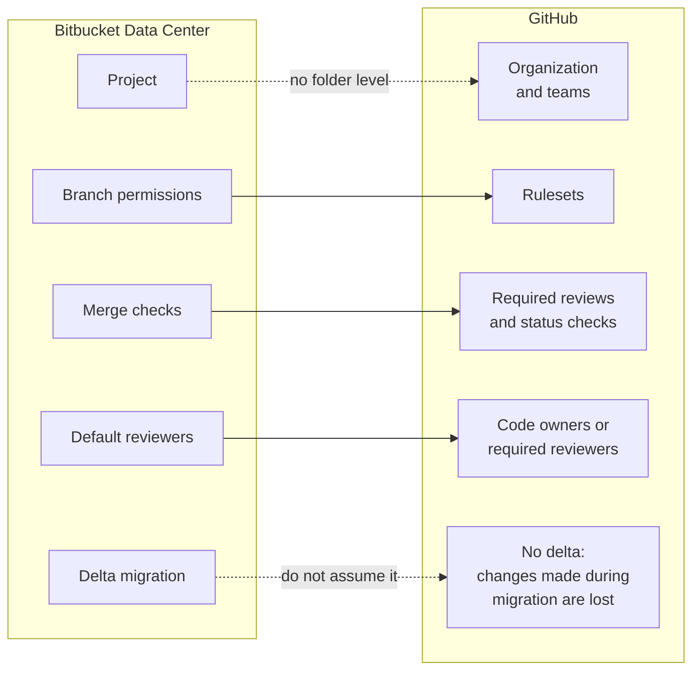

# Module 0.12: Coming from Bitbucket

**Audience:** Anyone on a team that keeps code in Bitbucket today and is moving
some or all of it to GitHub, or who works with such a team. Read
[Module 0.3](module-0-3-what-is-github.md) first. Conditional: skip it if you are
not coming from Bitbucket. Coming from Azure DevOps, GitLab or Jira instead? Those
are [Module 0.9](module-0-9-coming-from-azure-devops.md),
[Module 0.4](module-0-4-coming-from-gitlab.md) and
[Module 0.10](module-0-10-coming-from-jira.md), pages of their own.

**Format:** Reading only. No account needed, nothing to click.

**Timing budget:** ~12 minutes.

## Why this exists

Git does not change when a team moves to GitHub, so your commits, branches and
habits carry over. What changes is the layer around Git: how repositories are
grouped, who may push where, and what must pass before a pull request merges.
Bitbucket Data Center and GitHub cover the same ground with different names, and a
few of them look alike while behaving differently. This page orients you. It does
not repeat the full mapping, which is in the `github-for-ado-users` skill
(`skills/github-for-ado-users/SKILL.md`, "Planning a migration to GitHub"), and it
is not a migration runbook.

The Bitbucket claims on this page are about **Bitbucket Data Center** (the
documentation was read at version 10.5). Bitbucket Cloud differs in places, and
GitHub's migration tool does not list it as a source.

## What stays the same

A change is proposed in a pull request, reviewed, and merged. A reviewer can
approve or ask for changes. A build status appears on the pull request. If you use
those daily, you already know most of GitHub.

What this shows: where each Bitbucket concept lands on GitHub. Solid arrows are
renamed equivalents. Dotted arrows are the places where the shape differs, and the
last one is not a mapping at all: it is a limit of the migration tool.

## The mapping

| Bitbucket Data Center | GitHub | What to watch |
| --- | --- | --- |
| Project (a group of repositories, with its own permissions) | Organization, with teams | GitHub has no folder level between an organization and its repositories. Group access with teams, and note that a GitHub **Project** is a planning board, not this. |
| Project permissions: Admin, Write, Create repository, Read | A team's access to a repository: read, write or admin (and finer roles) | Give access to teams, not to individuals. |
| Repository permission overrides project permission | Team and repository access | Check what the team actually has on each repository before you assume. |
| Branch permission: Prevent deletion | Ruleset rule: **Restrict deletions** | On by default when you create the rule. |
| Branch permission: Prevent rewriting history | Ruleset rule: **Block force pushes** | Also on by default. |
| Branch permission: Prevent changes without a pull request | Ruleset rule: **Require a pull request before merging** | Pushes straight to the branch are blocked. |
| Exemptions for a user, group or access key | The ruleset's **bypass list** (roles, teams or apps) | Keep it short and approved. See the first trap below. |
| Merge check: Minimum approvals | Required number of approving reviews in the pull request rule | Set in the ruleset. |
| Merge check: Minimum successful builds | Rule: **Require status checks to pass before merging** | Use the exact check names. |
| Merge check: No "changes requested" status | A **Request changes** review blocks until that reviewer approves | The reviewer must come back and approve; it is not cleared by a later push alone. |
| Merge check: No incomplete tasks | Not checked for an equivalent | Check whether your plan has one before you promise it. |
| Default reviewers | **CODEOWNERS** (teams as `@org/team`), or the **Required reviewers** rule | Required reviewers is team-based and not available on user-owned repositories. |
| Build status from a linked CI server | Checks on the pull request, from Actions or an app | See [Module 0.13](module-0-13-coming-from-jenkins.md) for Jenkins pipelines. |
| Approve, Request changes | Approve, Request changes, Comment | The same words, so this one is easy. |

## Three traps

### 1. Rules are layered, and some sit above you

Bitbucket branch permissions belong to the repository or project. On GitHub a
ruleset can be set on the repository, and an organization or enterprise can add
rulesets you cannot edit. Overlapping rules layer, and the most restrictive
applies. If a push or merge is refused, find which ruleset said no before you ask
for a bypass. Never use a bypass without approval from whoever owns the rule.

### 2. A GitHub Project is not a Bitbucket project

Teams coming from Bitbucket hear "project" and look for the folder of repositories.
On GitHub that grouping is the organization and its teams. A GitHub Project is a
board for planning issues and pull requests across repositories. See
[Module 3.2](../3_advanced/module-3-2-projects-boards.md) when you reach it.

### 3. A migration is a snapshot, not a sync

GitHub's migration importer does not support delta migrations: "any changes that
happen during the migration will not migrate". Agree a freeze on the source
repository, migrate, check, then switch. Also expect to rebuild the pipelines that
reported status on your pull requests, since they were wired to your old CI server.

## If you are the one who migrates

Your team may have a platform group that does this. For the record, GitHub
Enterprise Importer lists Bitbucket Server and Data Center (version 5.14 and
later) as a source, driven by the GitHub CLI with the `gh bbs2gh` extension, and
needs an organization owner or a migrator role on the GitHub side and admin rights
on the Bitbucket side. Moving a repository that passes is not the same as moving
one that is fit: see the readiness tiers and the baseline in the skill named above.

## What people expect and get wrong

| Expectation | What actually happens |
| --- | --- |
| "Our Bitbucket projects become GitHub projects." | They become an organization and teams. A GitHub Project is a board. |
| "Branch permissions copy across." | They are rebuilt as rulesets, with the rule names above. |
| "Changes made during the migration come with it." | There is no delta migration; freeze first. |
| "A bypass is how we get unblocked." | A bypass needs the rule owner's approval, and an inherited rule may not offer one. |
| "My Bitbucket Cloud repositories use the same importer." | The importer does not list Bitbucket Cloud as a source. |

## Where to go next

- The `github-for-ado-users` skill, "Planning a migration to GitHub", for the
  readiness tiers, the sequence and the GHE.com differences.
- [Module 1.1: Getting Started](../1_beginners/module-1-1-getting-started.md), the
  hands-on part, once you have read
  [Module 0.5](module-0-5-what-kinds-of-tools-are-these.md) and
  [Module 0.6](module-0-6-what-is-an-llm-assistant.md).

## Sources and dates

Vendor features change, so check a claim before you rely on it for a decision that
is hard to undo. Checked on 2026-10-22: Atlassian's Bitbucket Data Center 10.5
documentation (project permissions, merge checks, default reviewers, branch
permissions, reviewing a pull request, build information) and GitHub Docs (teams,
code owners, pull request reviews, the available rules for rulesets, and
migrating from Bitbucket Server). The pages carry no update date. Not checked
here: what the importer migrates beyond the repository, size limits, Bitbucket
Cloud, whether your GitHub plan has an equivalent of "No incomplete tasks", and
plan limits for rulesets.

## Self-check

- What replaces a Bitbucket project on GitHub, and what is a GitHub Project?
- Which ruleset rule corresponds to "Prevent rewriting history"?
- Why must you freeze a repository before you migrate it?

Not confident on any of these? Re-read the section above, or the skill.

## Feedback

Something unclear, wrong, or worth improving on this page? Open a
Discussion in this repo (**Ideas** category). Concrete, actionable
feedback gets converted into a tracked issue, per this repo's own
issue-first convention — see `skills/github-issue-first/SKILL.md`'s
Discussions section.

---

Next: [Module 0.5: What kinds of tools are these?](module-0-5-what-kinds-of-tools-are-these.md),
then [Module 0.6: What Is an LLM Assistant?](module-0-6-what-is-an-llm-assistant.md).
