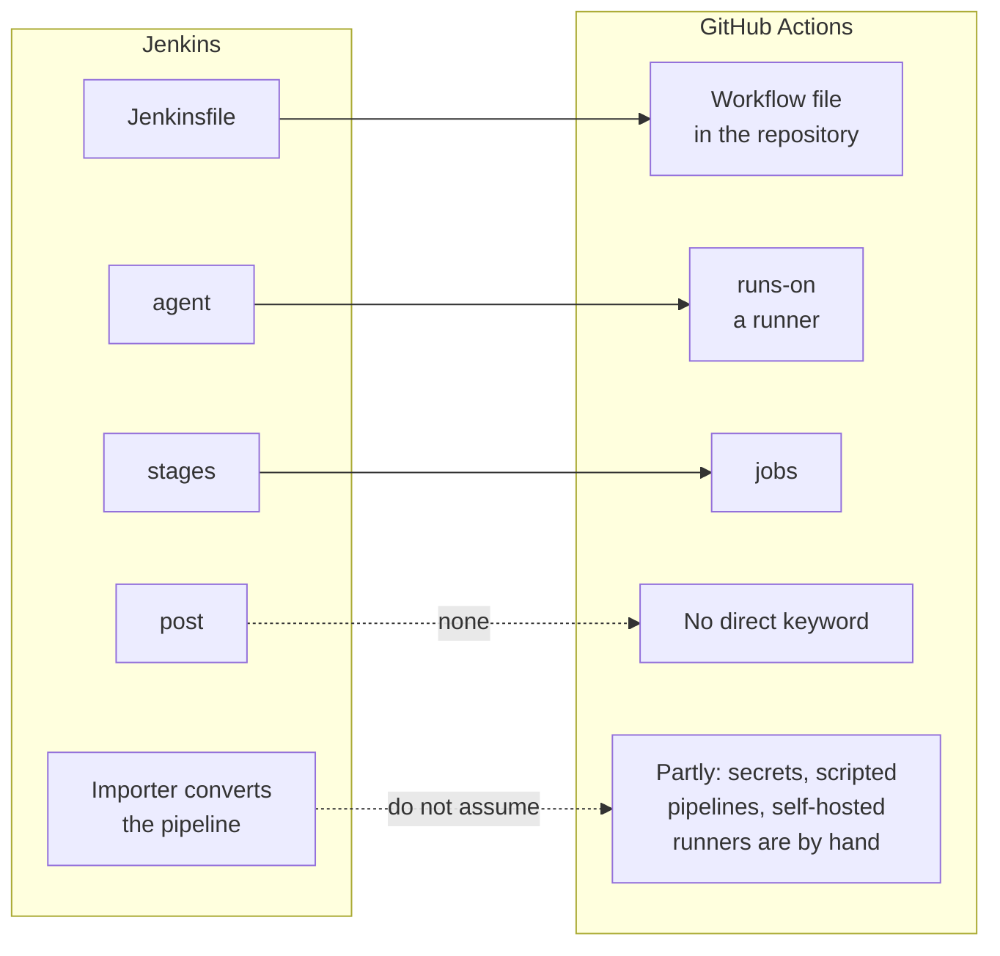

# Module 0.13: Coming from Jenkins

**Audience:** Anyone whose team builds and tests with Jenkins today and is moving
some or all of that to GitHub Actions, or who works with such a team. Read
[Module 0.3](module-0-3-what-is-github.md) first. Conditional: skip it if you do
not use Jenkins. Source control is a separate question: coming from Bitbucket,
Azure DevOps or GitLab instead? That is
[Module 0.12](module-0-12-coming-from-bitbucket.md),
[Module 0.9](module-0-9-coming-from-azure-devops.md) or
[Module 0.4](module-0-4-coming-from-gitlab.md).

**Format:** Reading only. No account needed, nothing to click.

**Timing budget:** ~12 minutes.

## Why this exists

Jenkins is a build server you run; GitHub Actions is a workflow system that lives
next to the code and runs on GitHub-hosted or self-hosted machines. Your commits
and branches do not change, but your pipeline does: it is a YAML file in the
repository, not a job configured on a server. GitHub's own page says the two
differ in how they are deployed (Jenkins is typically self-hosted, Actions is a
hybrid of GitHub-hosted and self-hosted runners) and in how they group work
(Jenkins stages group steps, Actions jobs group steps). This page orients you. It
is not a conversion guide, and it does not repeat the readiness tiers in the
`github-for-ado-users` skill ("Planning a migration to GitHub").

## What stays the same

A change triggers a build, the build runs steps, and the result appears on the
pull request. If you read a Jenkinsfile, you can read a workflow.

What this shows: where each Jenkins concept lands in GitHub Actions. Solid arrows
are renamed equivalents. Dotted arrows are the places where the shape differs, and
the last one is the thing people assume the conversion tool does for them.

## The mapping

These come from GitHub's page on migrating from Jenkins to GitHub Actions.

| Jenkins | GitHub Actions | What to watch |
| --- | --- | --- |
| Declarative or scripted pipeline (Jenkinsfile) | A workflow, written in YAML | There is no scripted form to port line by line. |
| `agent` | `runs-on` and `container` on a job | An agent is a machine you run; a runner can be GitHub-hosted or your own. |
| `stages` and `stage` | `jobs` | Jobs run in parallel unless you chain them with `needs`. |
| `steps` | `steps` in a job | |
| `environment` | `env` on a job or step | |
| `options` | `strategy`, `fail-fast`, `timeout-minutes` | |
| `parameters` and `input` | `inputs` (and outputs) | |
| `triggers` | `on`, with `push`, `pull_request` and `paths` | |
| Upstream project triggers | `needs` between jobs | |
| `cron` | `on: schedule` | |
| `when` | `if` on a job | |
| `matrix` and `axes` | `strategy: matrix` | Excludes have no direct form. |
| `tools` | The software preinstalled on the runner image | |
| `post` | No direct keyword | Use `if: always()` or a final step, and check what your cleanup relied on. |

Credentials, plugins and shared libraries are not covered by that page. The usual
landing places are GitHub secrets (and OpenID Connect to a cloud provider instead
of a stored key), actions, and reusable workflows, but check each against your own
pipelines instead of assuming.

## Three traps

### 1. A converter does not finish the job

GitHub Actions Importer has `audit` (analyze your footprint), `forecast`,
`dry-run` (convert one pipeline and print the workflow) and `migrate` (convert and
open a pull request). GitHub's page says mandatory build tools, scripted
pipelines, secrets, self-hosted runners and unknown plugins are migrated manually.
Expect many pipelines to convert only partly, and plan time to rebuild the rest.
A pipeline that converts with unsupported steps is "needs some work", not done.

### 2. Static agents become runners someone must manage

Named, hand-built agents have no automatic mapping to runners. Decide which jobs
use GitHub-hosted runners and which need your own (custom software, network
access), and who maintains them. Never attach a self-hosted runner to a public
repository: any fork's pull request could run code on it. Marketplace actions may
be unavailable on GHE.com; see the skill's GHE.com section.

### 3. Do not copy a generated mess

Jenkins estates often generate hundreds of near-identical jobs from a template.
Carrying that forward as hundreds of copied workflows moves the problem. Use
reusable workflows and a matrix, and check each pipeline against the baseline in
`github-repo-configure` before you call it migrated.

## What people expect and get wrong

| Expectation | What actually happens |
| --- | --- |
| "The importer converts everything." | It converts what it can; secrets, scripted pipelines and self-hosted runners are by hand. |
| "Our Jenkins plugins have Actions equivalents." | Some do, some do not; unknown plugins are manual. |
| "`post` maps to something." | There is no direct keyword. |
| "Our agents just become runners." | You decide which runners, and who maintains them. |
| "Credentials move across." | Secrets are rebuilt as GitHub secrets or OpenID Connect. |

## Where to go next

- The `github-for-ado-users` skill, "Planning a migration to GitHub".
- [Module 3.5: Actions, runners, and the Copilot coding agent](../3_advanced/module-3-5-actions-runners-and-agents.md),
  for what a workflow and a runner are.
- [Module 1.1: Getting Started](../1_beginners/module-1-1-getting-started.md), the
  hands-on part, once you have read
  [Module 0.5](module-0-5-what-kinds-of-tools-are-these.md) and
  [Module 0.6](module-0-6-what-is-an-llm-assistant.md).

## Sources and dates

Vendor features change, so check a claim before you rely on it for a decision that
is hard to undo. Checked against GitHub Docs on 2026-10-22: migrating from Jenkins
to GitHub Actions (the mapping table and the stated differences) and migrating
from Jenkins with GitHub Actions Importer (the commands and what must be done by
hand). The pages carry no update date. Not checked here: credentials, plugins and
shared libraries (the mapping page is silent on them), other CI sources for the
importer, and plan limits for Actions minutes.

## Self-check

- What replaces a Jenkins `agent`, and who maintains it if it is your own machine?
- Does a Jenkins `post` block have a direct Actions keyword?
- Name two things the importer leaves for you to do by hand.

Not confident on any of these? Re-read the section above, or the skill.

## Feedback

Something unclear, wrong, or worth improving on this page? Open a
Discussion in this repo (**Ideas** category). Concrete, actionable
feedback gets converted into a tracked issue, per this repo's own
issue-first convention — see `skills/github-issue-first/SKILL.md`'s
Discussions section.

---

Next: [Module 0.5: What kinds of tools are these?](module-0-5-what-kinds-of-tools-are-these.md),
then [Module 0.6: What Is an LLM Assistant?](module-0-6-what-is-an-llm-assistant.md).
