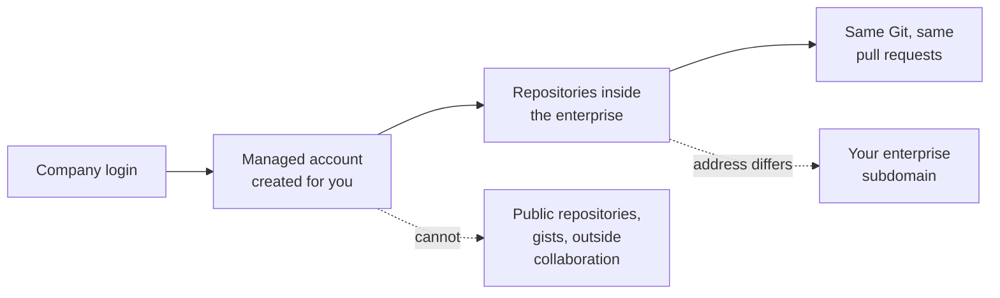

# Module 0.14: Using GitHub with a managed account (EMU and GHE.com)

**Audience:** Anyone whose company creates their GitHub account for them through
the company login (Enterprise Managed Users, "EMU"), or whose company uses GitHub
Enterprise Cloud with data residency (GHE.com). Read
[Module 0.3](module-0-3-what-is-github.md) first. Conditional: skip it if you
sign up for GitHub yourself with a personal account and your company does not
manage it. Not sure? If you sign in to GitHub with your company login and cannot
change your own name or email on GitHub, this page is for you.

**Format:** Reading only. No account needed, nothing to click.

**Timing budget:** ~10 minutes.

## Why this exists

Git and the pull-request habits in this course do not change. What changes is who
owns your account and what the company has switched off. With a personal account
you decide. With a managed account the company's identity provider creates it,
controls its name, profile and organization membership, and GitHub applies rules
you did not choose. Two terms are easy to mix up: **EMU** is the account model
(managed accounts), and **GHE.com** is a place GitHub runs (GitHub Enterprise
Cloud with data residency, on your company's own address). GHE.com always uses
managed accounts; EMU can also be used on github.com. This page says what that
means day to day. It is not an administrator's guide.

## What stays the same

You clone, branch, commit, push, open pull requests and review, in the same way,
and the issue-first and closure-gate habits apply unchanged. See
[Module 2.1](../2_intermediate/module-2-1-issue-first-and-closure-gate.md).

What this shows: the account comes from the company login and lives inside the
enterprise. Everything inside works like GitHub; the dotted lines are what the
account cannot do and where the address differs.

## What is different

| Topic | With a managed account | What to do |
| --- | --- | --- |
| Who creates the account | The company's identity provider provisions it | Sign in through the company login; there is no separate password to forget |
| Your name and email | Not editable on GitHub | Change them in the company's directory, not in GitHub's settings |
| Public repositories and gists | Not available | Share inside the company with **internal** repositories |
| Outside collaboration | A managed account "cannot create public content or collaborate outside your enterprise" | For an open-source contribution use a personal account, if your company's policy allows it (see the second trap) |
| Signed-out visitors | Repositories show as not found by default | Share a link only with people who can sign in |
| Addresses on GHE.com | The API, container registry, raw files, SSH clone, OpenID Connect issuer and SCIM address move to your enterprise's own `ghe.com` subdomain | Update bookmarks, scripts and documentation that hard-code `github.com`, `ghcr.io` or `githubusercontent.com` |
| API requests | Every request must be authenticated | A script that worked unauthenticated on github.com needs a token |
| GitHub Marketplace | Browsing and installing from it is unavailable | Use an action from its own repository, and check it works |
| Actions that call `api.github.com` | They can fail on GHE.com | Check each third-party action; `GITHUB_TOKEN` does not reach resources on github.com |
| macOS GitHub-hosted runners | Currently unavailable | Plan a self-hosted macOS runner, or wait |
| Some newer features | Preview features can arrive later than on github.com | Check the docs before you promise a feature |

## Three traps

### 1. Two accounts, one editor

You may end up with a managed account for work and a personal account for
everything else. Your editor and your Git configuration can use either. Before you
push, check which account is signed in and which address the remote uses. A work
repository belongs to the managed account; pushing company code from a personal
account, or the reverse, is a mistake that is hard to undo. See
[Module 0.8](module-0-8-connect-vs-code-to-git-github-and-an-llm.md).

### 2. Do not assume you may contribute outside

A managed account cannot take part in public repositories. Whether you may use a
personal account for open-source work, and on whose time, is your company's rule,
not GitHub's. Ask first. If you are allowed, keep the two accounts apart as above,
and follow [Module 2.7](../2_intermediate/module-2-7-contributing-to-someone-elses-repo.md)
from the personal one.

### 3. Rules can sit above you

The enterprise or your organization can set rulesets, restrict who creates
repositories, and limit tags, and a repository owner cannot loosen them. If a
push, a merge or a new repository is refused, find which rule said no, then ask
the person who owns it. Do not look for a way around it. See
[Module 0.12](module-0-12-coming-from-bitbucket.md) for how layered rules behave.

## What people expect and get wrong

| Expectation | What actually happens |
| --- | --- |
| "I can change my name and email in GitHub." | They come from the company directory. |
| "I can make this repository public to share it." | Public repositories are not available; use internal. |
| "I can fork that open-source project from my work account." | A managed account cannot collaborate outside the enterprise. |
| "My script works because the URL is the same." | On GHE.com the address moves to your enterprise subdomain. |
| "Any Marketplace action will just work." | You cannot browse the Marketplace, and some actions call github.com and fail. |

## Where to go next

- The `github-for-ado-users` skill, "Planning a migration to GitHub", for the
  GHE.com differences from an administrator's side.
- [Module 0.8: Connect VS Code to Git, GitHub and an AI assistant](module-0-8-connect-vs-code-to-git-github-and-an-llm.md)
  for the sign-in steps, once you know which account you use.

## Sources and dates

Vendor features change, so check a claim before you rely on it for a decision that
is hard to undo. Checked against GitHub Docs on 2026-10-22: "About Enterprise
Managed Users" and the feature overview for GitHub Enterprise Cloud with data
residency. The pages carry no update date. Not checked here: Copilot plans on
managed accounts, forking inside an enterprise, which identity providers your
company uses, and how your company's policy treats a personal account.

## Self-check

- What is the difference between EMU and GHE.com?
- Where do you change your name and email with a managed account?
- Why must you check which account is signed in before you push?
- A script that clones from `github.com` stops working after your company moves to
  GHE.com. What changed?

Not confident on any of these? Re-read the section above.

## Feedback

Something unclear, wrong, or worth improving on this page? Open a
Discussion in this repo (**Ideas** category). Concrete, actionable
feedback gets converted into a tracked issue, per this repo's own
issue-first convention — see `skills/github-issue-first/SKILL.md`'s
Discussions section.

---

Next: [Module 0.5: What kinds of tools are these?](module-0-5-what-kinds-of-tools-are-these.md),
then [Module 0.6: What Is an LLM Assistant?](module-0-6-what-is-an-llm-assistant.md).
