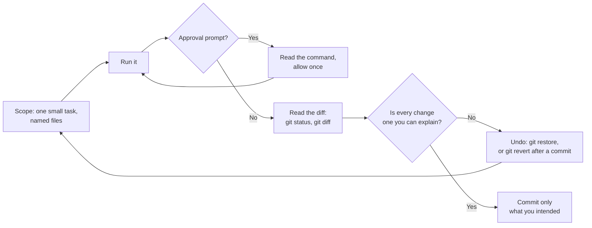

# Module 1.7: Working with an AI assistant day to day

**Audience:** Anyone who uses an AI assistant in their editor and has done
[Module 0.6](../0_prerequisites/module-0-6-what-is-an-llm-assistant.md), the
local Git basics in [Module 1.2](module-1-2-local-git-basics.md), and ideally
[Module 1.6](module-1-6-skills-instructions-and-mcp.md).

**Format:** Self-paced. Read the habits, then do one exercise in the sandbox
repository. Facilitator-note callouts mark an optional group activity.

**Timing budget:** ~35 minutes.


## Learning objectives

- Scope a task so the assistant has one small, checkable job.
- Read an approval prompt before you allow it, and choose the narrowest option.
- Read what changed with `git status` and `git diff`, and spot what you did not ask for.
- Undo an assistant's change with the right Git command, and know what an in-editor undo does not cover.

## Why this exists

[Module 0.6](../0_prerequisites/module-0-6-what-is-an-llm-assistant.md) explains
what an assistant is and why you check what it did, and its paper exercise
practises the thinking. This module is the same thinking at the keyboard: the
loop you repeat every time you ask an assistant for something. It teaches the
habit, not one product. The steps below use VS Code with GitHub Copilot Chat in
agent mode, because that is what most colleagues have; another tool has the same
loop with different buttons, and its vendor page is the place for the buttons.



What this shows: the loop. The two places a person must act are the approval
prompt, before something happens, and the diff, after it. Undo is part of the
loop, not a failure.

## 1. Scope the task

Start with one bounded task in a project you know, so you can tell the assistant's
changes from your own, and say what a good result looks like. A prompt that works
names four things:

| Say | Example |
| --- | --- |
| The goal | "Fix the three typos in `practice.md`" |
| What may change | "Edit only `practice.md`" |
| What must not change | "Do not touch other files or run commands" |
| How you will know it is done | "Show me each fix as a list" |

A vague prompt ("clean this up") gives a large diff you cannot check. If a task is
bigger, ask for a plan first and then do it one step at a time.

## 2. Read each approval prompt

When an agent wants to run a terminal command or call a tool, VS Code asks first.
Its documentation describes three choices: **Allow** (this call only), allow for
the **session** or **workspace**, and **Always**. The documentation also says that
a tool being switched on is a separate matter from you approving a call.

- Open the details (the chevron next to the tool name) and read the command or its
  inputs before you press anything.
- Choose **Allow**, once. Do not choose **Always** while you are learning what the
  assistant does. VS Code's own advice is to use manual permissions for an
  interactive first task and to review each approval request.
- Refuse anything you do not understand, and anything that pushes, merges, deletes,
  or sends something off your machine ([Module 0.6](../0_prerequisites/module-0-6-what-is-an-llm-assistant.md)).
  A command that finished has already happened.

## 3. Read what changed

Do not read the assistant's summary first. Read the changes:

```bash
git status
git diff
```

`git status` lists the files that changed, including new ones; `git diff` shows
the lines. The Source Control view in VS Code shows the same thing. Look for:

- **Files you did not name.** The task said one file; the diff shows three.
- **Deleted lines.** Check that nothing was removed to make a problem "go away",
  such as a test or a check.
- **New dependencies or configuration.** A changed `package.json` or workflow is
  more than a typo fix.
- **Anything that looks like a secret.** See [Module 1.5](module-1-5-what-never-goes-in-a-repo.md).

Run the tests if there are any, and read the diff again after you run them. VS Code's
guidance is the same: read generated code before you commit it, and run tests
after the change.

## 4. Undo with the right tool

| Situation | Use | What happens |
| --- | --- | --- |
| The change is not committed and you want it gone | `git restore <file>` | Discards the edit. It is gone for good, because Git never recorded it. A new file the assistant created is untracked: delete it instead |
| The change is committed | `git revert <commit>` | Adds a new commit that undoes the old one. Safe on a shared branch |
| You want to step back inside the chat | The editor's **Undo** on a pending edit, or **Restore Checkpoint** | Rolls back workspace files to an earlier point in the conversation |

These are the same tools as [Module 1.2](module-1-2-local-git-basics.md). The last
row has limits. VS Code's documentation says checkpoints do not reverse completed
terminal commands, network requests, deployments, or changes to external
services, and that they are temporary and do not replace Git. So use Git for
anything you want to keep or discard for certain.

## Exercise: one small task, from prompt to undo

**Permissions:** the sandbox repository cloned locally (Module 1.2) and GitHub
Copilot Chat available in VS Code, in agent mode. If you do not have it, read the
exercise and skip to the success state; nothing here needs write access to the
shared sandbox, because you only push if you choose to.

**Starting state:** the sandbox clone is open in VS Code, `git status` is clean,
and you are on `main` with the latest changes pulled. Use a private branch; do not
work on `main`.

1. Create a branch: `git checkout -b assistant-practice-<your-name>`. Then create a
   file `practice-<your-name>.md` containing three short lines of your own, with
   one typo in each. Commit it: `git add practice-<your-name>.md` and
   `git commit -m "docs: add practice file"`. The file is now tracked.
2. **Scope.** In Copilot Chat (agent mode) ask: "Fix the typos in
   `practice-<your-name>.md`. Edit only that file. Do not run any commands."
   Before you run it, say which of the four parts of a good prompt you included.
3. **Read.** Run `git status` and `git diff`. Confirm that only the practice file
   changed and that you can explain every changed line. Then undo it with
   `git restore practice-<your-name>.md` and confirm `git status` is clean.
4. **Approve.** Ask: "Run `git status` in the terminal and tell me what it says."
   An approval prompt appears. Open the details, read the command, and choose
   **Allow** once. Note what the other choices would have allowed.
5. **Commit and revert.** Ask for the typo fix again, check the diff, and commit
   it: `git commit -am "docs: fix typos"`. Now undo the committed change with
   `git revert HEAD`, accepting the message Git offers, and confirm with
   `git log --oneline -3` that you see the fix and the revert.

**Success state:** you changed only the practice file; you read `git diff` before
each commit; you restored one uncommitted change with `git restore` and undid one
committed change with `git revert`; you allowed one approval prompt once, after
reading it; and `git status` is clean.

**Likely errors:**

- The assistant changed other files too: undo them with `git restore <file>` and
  tighten the prompt ("Edit only ... Do not touch other files").
- It created a new file, and `git restore` does nothing: new files are untracked,
  so delete the file instead.
- No approval prompt appears: the assistant did not need a command, or auto-approve
  is switched on in your settings. Ask for the command by name, and check your
  settings before you rely on prompts.
- `git revert HEAD` stops with an editor open: save and close the message to finish.
- You are on `main`: switch to your scratch branch before any edit; do not push
  this work to `main`.

**Cleanup:** switch back (`git checkout main`), delete the scratch branch
(`git branch -D assistant-practice-<your-name>`), and check that `git status` is
clean. If you pushed the branch, delete it on the remote too
(`git push origin --delete assistant-practice-<your-name>`).

> **Facilitator note (optional group activity):** have each person give the same
> vague prompt ("clean up the file") and compare the diffs, then repeat with a
> scoped prompt. The point is that scope, not the tool, sets how checkable the
> result is.

### Model answer

A good prompt in step 2 names the goal (fix typos), what may change (that one
file), what must not (other files, commands), and a check (the diff). The diff
shows only the practice file. After `git restore` the tree is clean. In step 4 the
prompt shows the exact command, and **Allow** once approves just that call. After
step 5 `git log --oneline -3` shows the revert on top of the fix.

## What stays the same

An assistant's change is a change like any other. It goes into a branch, a pull
request and review, and the usual rule applies: record evidence for each acceptance
criterion before an issue is called done. See
[Module 2.1](../2_intermediate/module-2-1-issue-first-and-closure-gate.md) and
[Module 2.4](../2_intermediate/module-2-4-writing-a-reviewable-pr.md). Never
paste a secret into a prompt. If the assistant opens a pull request itself, review
it as you would a colleague's; [Module 4.1](../4_next-step/module-4-1-reviewing-changes-an-ai-agent-wrote.md)
covers that.

## Sources and dates

Vendor products change fast, so check a claim before you rely on it. The VS Code
claims were checked against Visual Studio Code's documentation on 2026-10-11: the
agent tools and approval page (the Allow, session and workspace, and Always
choices, and that a tool being enabled is separate from approval), "Review and
revert agent changes" (checkpoints, Keep and Undo, and what checkpoints do not
cover), and "Best practices for using AI in VS Code" (scope one small task, review
before you commit, manual permissions at first).

Not checked here: the exact button labels in your installed version, the
`chat.tools.terminal.autoApprove` setting and other settings, and how Claude
Code, the Copilot CLI, Codex or a JetBrains IDE ask for approval and undo. The
habit applies to them; read the vendor page for the buttons.

## Self-check

- What four things does a scoped prompt say?
- What do you read first after an assistant finishes: its summary or the diff?
- What is the safest choice at an approval prompt while you are learning, and why?
- An assistant edited a file and you have not committed. Which command discards it?
  Which command do you use if you already committed?
- A chat checkpoint rolled back your files. Does it also undo a command the agent
  ran? What do you rely on for certain?

Not confident on any of these? Re-read the matching section, then check the
answers.

### Self-check answers

- The goal, what may change, what must not change, and how you will know it is
  done.
- The diff (`git status`, `git diff`), because the summary describes what the
  assistant says it did.
- **Allow** once, after reading the command: you see exactly what happens, and
  you do not approve actions you have not met yet.
- `git restore <file>` before a commit; `git revert <commit>` after one.
- No. Checkpoints do not reverse completed terminal commands or changes outside the
  workspace, and are temporary. Git is what you rely on.

## Feedback

Something unclear, wrong, or worth improving in this module? Open a
Discussion in this repo (**Ideas** category). Concrete, actionable
feedback gets converted into a tracked issue, per this repo's own
issue-first convention — see `skills/github-issue-first/SKILL.md`'s
Discussions section.

---

Next: [Module 2.1: Issue-first and the closure gate](../2_intermediate/module-2-1-issue-first-and-closure-gate.md)
(read [Module 2.9: Safety with skills and MCP servers](../2_intermediate/module-2-9-safety-with-skills-and-mcp-servers.md)
before you add anything you did not write yourself).
