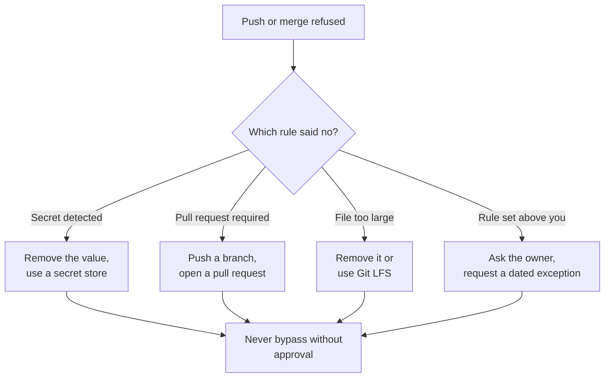

# Module 2.10: When a push is blocked

**Audience:** Anyone who has done Module 1.2 and Module 1.5 and pushes to a
repository that has protections switched on, which is most repositories in a
company. Best read after Module 2.2.

**Format:** Self-paced. Read the four ways a push or merge is blocked, then work
through the paper exercise. Facilitator-note callouts mark an optional group
activity. No sandbox needed.

**Timing budget:** ~25 minutes.

## Learning objectives

- Tell the four common reasons a push or merge is refused and who owns each rule.
- Respond to a push-protection block without bypassing it, and know what a bypass
  records.
- Choose the right fix for a size-limit block or a pull-request-required block.
- Know when to ask the rule's owner for a dated exception instead of working
  around the rule.

## Why this exists

Companies switch protections on so that mistakes are caught before they spread:
secrets, huge files, and direct pushes to the main branch. The first time one of
them stops you, the message is short and the temptation is to find the quickest
way past it. The quick way is usually the wrong one. This module is the routine for
the moment you are stopped. It builds on Module 1.5 (what never goes in a
repository) and Module 2.8 (why the rules exist, including "rotate first").

What this shows: find out which rule refused you first, because the fix and the
person to ask depend on it. All four paths end at the same rule: do not bypass
without approval.

## 1. A secret was detected

Push protection checks a push for known secret patterns and blocks it before the
secret reaches the repository. GitHub's documentation says it covers pushes from
the command line, commits made in the GitHub web interface, file uploads and
requests to the REST API. It is switched on by an administrator or security
manager; a repository without it will not stop you, which is why Module 1.5 matters
anyway.

When it blocks you:

1. Do not bypass it. A real secret in a commit is a leak, and your push has not
   reached the repository yet, so this is the cheap moment to fix it.
2. Remove the value from the file and use a secret store or an environment variable
   instead. If the secret is in your last local commit, undo that commit with
   `git reset --soft HEAD~1`, fix the file, and commit again. Do not just add a
   second commit that deletes it: the first commit still holds the value.
3. If you pasted the secret anywhere else (a chat, a ticket, an assistant prompt, a
   log), treat it as exposed and rotate it at its source. See Module 2.8, rule 5.

A bypass is for a finding you have checked and can justify. By default anyone with
write access can bypass with a reason, and GitHub's documentation lists three:
*it's used in tests*, *it's a false positive*, and *I'll fix it later*. The first
two close the alert; the third leaves it open. Every bypass creates an alert and an
audit-log event, and sends an email to the owners. Some organizations require
approval before a bypass (delegated bypass). "I'll fix it later" for a real secret
is not a reason: the secret stays in your history.

## 2. A pull request is required

A ruleset can require changes to reach the main branch through a pull request, and
can block force pushes and deletions. If your push to `main` is refused, the rule
is working. Create a branch, push it, and open a pull request from it, as in Module
1.1. Do not ask for a bypass to push straight to `main`: bypass lists are short on
purpose.

## 3. A file is too large

GitHub warns when a file passes 50 MiB (the push still works) and blocks files
larger than 100 MiB, and recommends repositories under 1 GB. If a blocked file is in
a commit you have not pushed, undo that commit, remove the file or move it to Git
LFS, and commit again. Do not add the file to `.gitignore` after it is already in a
commit; that does nothing for the commit.

## 4. A rule set above you

An organization or enterprise can set rulesets, restrict who creates repositories,
and limit tags, and a repository owner cannot loosen them. If a refusal does not
come from your repository's own settings, you cannot fix it there. Find the rule
that said no, ask the person who owns it, and if you genuinely need an exception,
request one with a reason, an owner, a compensating control and an expiry date.
The skill `skills/github-repo-configure/SKILL.md` ("The minimum baseline") describes
that exception shape. Rules are layered, and the most restrictive applies.

## Exercise: four refusals

**Permissions:** none. This is a paper exercise; you do not need a repository or an
account.

**Starting state:** you have the four messages below. They are invented; no real
secret or repository is involved.

1. Push to `main` is refused: "Push cannot contain secrets". The report points at
   line 12 of `config/settings.json`, which contains a long random-looking token
   after the word `apikey`.
2. Push to `main` is refused: "Changes must be made through a pull request". You
   have two local commits on `main`.
3. Push is refused: "File is 134.2 MB; this exceeds GitHub's file size limit of
   100.00 MB". The file, `recordings/session.bin`, is in your last local commit.
4. You open a pull request and it cannot merge. The merge button says a required
   status check has not reported, but your repository's own settings list no
   such check.

For each, write down: **what blocked you, who owns the rule, your next action, and
the one thing you must not do.**

**Success state:** for each message you named the rule and its owner, chose a fix
that removes the cause, and named the thing not to do (bypass, hide the file, or
work around a rule that is set above you). A model answer follows.

**Likely errors:**

- You chose "bypass: it's a false positive" for the token in message 1 without
  checking. Check first: is it a real credential? If so, remove it.
- You moved the large file in message 3 to `.gitignore` and pushed again. The
  commit still contains it; undo the commit first.
- You searched your repository's settings for the missing check in message 4. A
  required check can come from an organization-wide ruleset that you cannot edit
  from the repository; ask the owner.
- You said "I'll rotate the token later" in message 1. If it went anywhere besides
  your machine, rotate first.

**Cleanup:** none needed. Nothing was created.

> **Facilitator note (optional group activity):** have each person choose a bypass
> reason for message 1 and defend it. Discuss why only one answer survives
> (remove the value) and what each bypass would have recorded.

### Model answer

1. **Blocked by:** push protection (secret scanning). **Owner:** the repository
   administrator or security manager. **Next action:** remove the token, use a
   secret store or environment variable, undo your last commit with
   `git reset --soft HEAD~1` if it is there, and commit again; rotate it if it went
   anywhere else. **Do not:** bypass with "I'll fix it later".
2. **Blocked by:** a ruleset requiring a pull request. **Owner:** whoever set the
   ruleset (repository admin, or the organization). **Next action:** move your
   commits to a branch, push it, and open a pull request. **Do not:** ask for a
   bypass to push to `main`.
3. **Blocked by:** the file size limit (100 MiB). **Owner:** GitHub's own limit, with
   your team's policy on LFS. **Next action:** undo the last commit, remove the
   file or move it to Git LFS, commit again. **Do not:** rely on `.gitignore` after
   the file is already committed.
4. **Blocked by:** a required status check, probably from an organization-wide
   ruleset. **Owner:** the organization or platform team. **Next action:** open the
   pull request's checks to see the check name, then ask the owner why it did not
   report and whether your branch qualifies. **Do not:** try to bypass or disable it.

## What people expect and get wrong

| Expectation | What actually happens |
| --- | --- |
| "Bypass is how you get unblocked." | A bypass is for a checked finding and records an alert, an audit event and an email. |
| "Deleting the secret in a new commit is enough." | The old commit still holds it; undo it before you push, or rotate. |
| "`.gitignore` fixes a committed big file." | It only affects files not yet tracked. |
| "The rule is in my repository's settings." | It may be set by the organization or enterprise, where you cannot change it. |

## Sources and dates

Vendor features change, so check a claim before you rely on it for a decision that
is hard to undo. Checked against GitHub Docs on 2026-10-22: "About push
protection" (what it covers, bypass reasons, what a bypass records, delegated
bypass), "About large files on GitHub" (the 50 MiB warning, the 100 MiB block, the
repository size recommendation), and "About rulesets". The pages carry no update
date. Not checked here: the exact wording of the messages (the ones above are
invented), how organization-wide rulesets appear in a repository on your plan, and plan prices.

## Self-check

- Name the four common reasons a push or merge is refused.
- What does a bypass of push protection record, and who can bypass by default?
- Why is a second commit that deletes a secret not a fix?
- A refusal does not come from your repository's settings. Who do you ask?

Not confident on any of these? Re-read the matching section above.

## Feedback

Something unclear, wrong, or worth improving in this module? Open a
Discussion in this repo (**Ideas** category). Concrete, actionable
feedback gets converted into a tracked issue, per this repo's own
issue-first convention — see `skills/github-issue-first/SKILL.md`'s
Discussions section.

---

Next: [Module 3.1: Branch protection and rulesets](../3_advanced/module-3-1-branch-protection-and-rulesets.md),
or [Module 3.4: Security response basics](../3_advanced/module-3-4-security-response.md).
